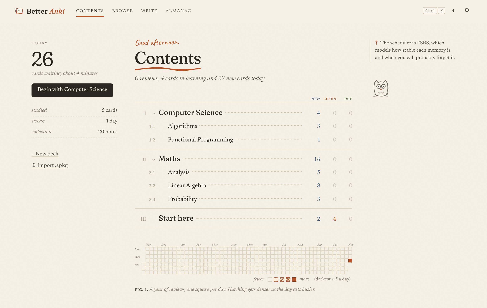
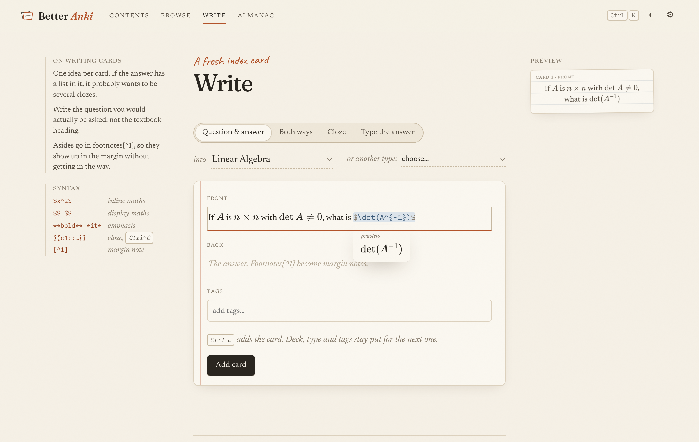
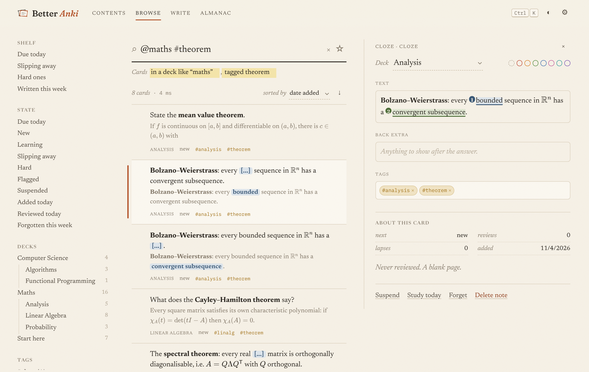
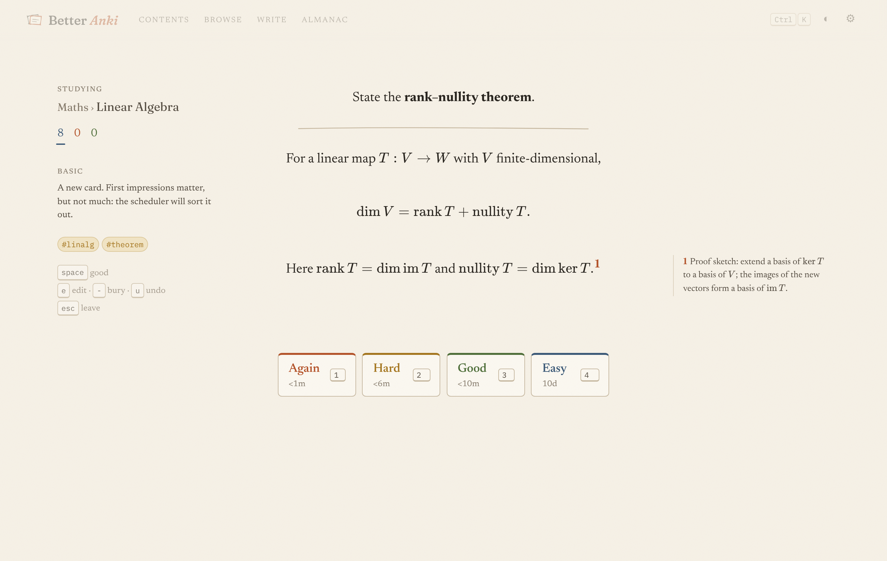

# Better Anki

A calmer, faster front end for your Anki collection, in the browser. It uses the
official `anki` Python package underneath, so scheduling (FSRS), card templates,
clozes, search and `.apkg` files all behave exactly as they do in Anki. What changes
is everything you look at and type into.



## What is different from Anki

**Writing cards.** Fields are Markdown with live preview, in the manner of
Obsidian. Type `$` and the editor pairs it; as you write LaTeX a small preview
floats under the expression and re-typesets on every keystroke. Move the cursor
away and the source collapses into rendered maths; click it to get the source
back. Bold, italics, headings, links, images and cloze deletions behave the same
way. `⌘⇧C` wraps a selection in the next cloze number. Pasting an image uploads it
to your media folder.



**Margin notes.** Markdown footnotes (`[^1]`) are lifted out of the card during
review and set in the right-hand margin beside the line that cites them, so
asides and proof sketches stay out of the answer until you want them.

**Browsing.** The browser is a single page with three columns: filters on the
left, the cards themselves (rendered, with maths) in the middle, and the selected
card open for editing on the right. Edits save themselves. Search is instant
(results update as you type, usually in a few milliseconds), autocompletes tags,
decks and keywords, and reads your query back as an English sentence whose
clauses you can click to negate or remove. Anki's full search language still
works, plus a few shorthands:

| You type          | Anki sees                  |
|-------------------|----------------------------|
| `#calculus`       | `tag:calculus`             |
| `@analysis`       | `deck:*analysis*`          |
| `is:due`          | `is:due` (unchanged)       |
| `is:fragile`      | `prop:r<0.8` (likely to be forgotten) |
| `is:hard`         | `prop:d>0.7`               |

`j`/`k` move through results, `x` selects, shift-click selects a range, and a bar
appears for bulk moves, tags, flags, suspension and deletion. Nothing asks for
confirmation; everything can be undone with `⌘Z` or the button on the toast.



**Reviewing.** One card, set in a book face, with a hand-drawn rule between
question and answer. The left margin shows where you are and, once you reveal the
answer, what the scheduler thinks of the card (recall odds, stability,
difficulty). Keys are Anki's: space, then 1–4.



**Everything else.** A command palette on `⌘K`, a contents page laid out like the
front of a book, an almanac of statistics, a LaTeX preamble for your own macros
(`\R`, `\norm{x}` and friends come predefined), light and dark themes, and `?`
for the list of shortcuts.

## How your cards are stored

Anki fields are HTML, and every Anki client expects them to be. Better Anki
therefore stores each field as the rendered HTML (with maths as `\(...\)` for
MathJax) followed by an invisible HTML comment holding the Markdown source. Your
cards keep working in Anki desktop, AnkiMobile and AnkiDroid. If you later edit a
field in Anki desktop, Better Anki notices that the HTML no longer matches and
treats the HTML as the source from then on.

Notes written in Anki's own editor open here converted to Markdown for editing,
and are only rewritten if you change them.

Two limitations follow from this. Macros from the preamble are rendered by KaTeX
in this app, but Anki's MathJax will not know them. And notetype CSS is not
applied here, since cards are set in the app's own typography.

## Running it

You need Python 3.10+ and Node 20+.

```sh
python -m venv .venv
.venv/bin/pip install -e "backend[dev]"

cd frontend
npm install
npm run build        # builds into backend/better_anki/static
cd ..

.venv/bin/python -m better_anki          # http://127.0.0.1:8000
```

On first run this creates `data/collection.anki2` with a small demo collection:
a "Start here" deck that explains the app, and some linear algebra, analysis,
probability and algorithms cards.

To use your real collection, **quit Anki desktop first** (two programs must not
write to the same collection at once) and point the server at it:

```sh
.venv/bin/python -m better_anki --collection ~/.local/share/Anki2/"User 1"/collection.anki2
# macOS: ~/Library/Application\ Support/Anki2/User\ 1/collection.anki2
```

It is worth taking a backup the first time. Syncing with AnkiWeb is not built in
yet; sync from Anki desktop before and after a session.

### Developing

```sh
.venv/bin/python -m better_anki --reload   # API on :8000
cd frontend && npm run dev                  # UI on :5173, proxies /api
```

Tests: `.venv/bin/python -m pytest backend` and `cd frontend && npm test`.

## Layout

```
backend/better_anki/
  fields.py       Markdown ↔ Anki field encoding (and legacy HTML → Markdown)
  search.py       search shorthands on top of Anki's query language
  store.py        the single open collection, behind a lock
  seed.py         the demo collection
  routes/         decks, review, browse/search, notes, stats, media and import/export
frontend/src/
  editor/         CodeMirror 6 live preview: maths, marks, clozes, footnotes
  pages/          Contents, Review, Browse, Write, Almanac, Settings
  components/     search box, card panel, hand-drawn sketches (rough.js), charts
  lib/            KaTeX rendering, query parsing and completion, small stores
```
