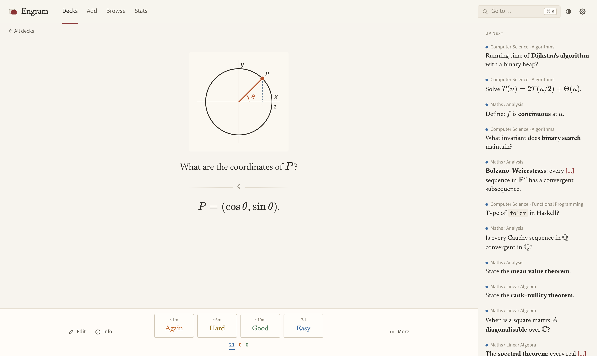
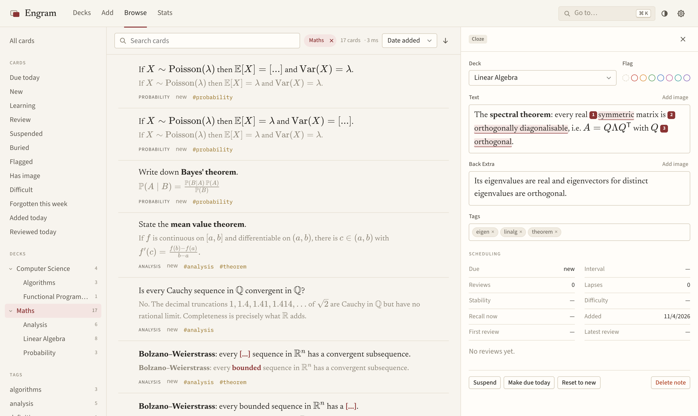

# Engram

Engram is a flashcard app. It uses the `anki` Python package for scheduling
and storage, and keeps cards in an ordinary Anki collection file. Card fields
are Markdown, and maths is written in LaTeX.

<picture>
  <source media="(prefers-color-scheme: dark)" srcset="docs/study-dark.png">
  
</picture>

## Features

- Decks and subdecks, each with its own daily limits
- Studying one deck, several decks, or all decks together
- A list of upcoming cards next to the current card
- A rendered preview under each field while editing
- Cloze deletions, including inside maths
- Pasting and resizing images
- Searching, editing and bulk-editing cards, with undo
- Statistics
- LaTeX macros shared by all cards
- Light and dark themes
- Keyboard shortcuts, mostly the same as Anki's

<picture>
  <source media="(prefers-color-scheme: dark)" srcset="docs/browse-dark.png">
  
</picture>

## Running it

You need Python 3.10+ and Node 20+.

```sh
git clone https://github.com/daohongliu/engram.git
cd engram

python -m venv .venv
.venv/bin/pip install -e "backend[dev]"

cd frontend
npm install
npm run build        # builds into backend/engram/static
cd ..

.venv/bin/python -m engram          # http://127.0.0.1:8000
```

The first run creates a small demo collection (a few maths and computer
science decks). Delete the decks whenever you like, or start empty with
`ENGRAM_NO_DEMO=1`.

Everything is stored in `data/`: `collection.anki2` holds notes, cards and
review history, and `collection.media/` holds images. To back up, copy that
folder. `--collection path/to/collection.anki2` uses a different
location.

### Installing as an app

If you'd like it in its own window, with a Dock or taskbar icon, open
http://127.0.0.1:8000 while the server is running and:

- **Chrome or Edge:** click the install icon at the right of the address bar,
  or choose *Install Engram* from the menu.
- **Safari (macOS 14+):** choose *File › Add to Dock*.

The installed app still needs the server running in the background.

### Connecting Claude (MCP)

Engram includes an optional MCP server, so Claude or another agent can search
your cards, add new ones and change existing ones. It needs a few extra
packages and a password:

```sh
.venv/bin/pip install -e "backend[mcp]"
.venv/bin/python -m engram hash-password      # prints a hash for the password you type
export ENGRAM_MCP_PASSWORD_HASH='...'
.venv/bin/python -m engram --mcp-port 8001
```

The MCP server is then at http://127.0.0.1:8001/mcp. It runs in the same
process as Engram but on its own port, which only serves the MCP endpoints and
their sign-in page. When Claude connects, it opens that page and you enter the
password. Cards added by the agent go to a deck called "AI inbox" and are
tagged `ai`, unless you ask for another deck.

To use it from claude.ai, the MCP port has to be reachable over HTTPS, for
example behind a reverse proxy. Set `ENGRAM_MCP_PUBLIC_URL` to that address.
Other settings: `ENGRAM_MCP_INBOX` (the deck name) and `ENGRAM_MCP_DB` (where
sign-in tokens are kept, `data/mcp.db` by default).

### Developing

```sh
.venv/bin/python -m engram --reload   # API on :8000
cd frontend && npm run dev                  # UI on :5173, proxies /api
```

Tests: `.venv/bin/python -m pytest backend` and `cd frontend && npm test`.

## Layout

```
backend/engram/
  fields.py       Markdown rendering (maths, image sizes) and field storage
  search.py       plain-text search and sidebar filters
  store.py        the single open collection, behind a lock
  seed.py         the demo collection
  routes/         decks, review, browse, notes, stats, media and settings
  mcp_server/     the optional MCP server and its sign-in
frontend/src/
  editor/         CodeMirror 6 field editor: source view, or live preview in place
  pages/          Decks, DeckOverview, Review, Add, Browse, Stats, Settings
  components/     card editor, card info, charts, command menu
  lib/            KaTeX rendering, API stores, keyboard handling
```

## License

MIT; see [LICENSE](LICENSE). Engram depends on the
[`anki`](https://pypi.org/project/anki/) package, which is licensed under the
AGPL-3.0, so its terms also apply when you distribute Engram together with it.
